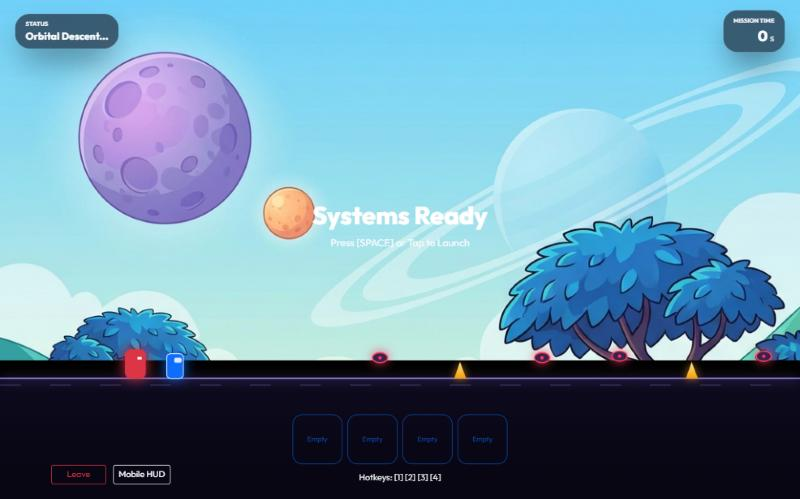

# Planet Hopper

**A wellness challenge app with a browser runner game built in.** Complete real-life wellness challenges to earn credits, spend them on power-ups, then hop across five planets while dodging obstacles and a chaser.

**Live demo:** _coming soon_ · click **Play as guest** to try it without signing up.



Built solo for the Back-End Web Development module (ST0503) at Singapore Polytechnic, Jan–Feb 2026, then polished and deployed in Nov 2026.

## Features
- **Runner game** on HTML canvas: jump, duck and ground-slam past spikes and drones, with per-planet speed, music and backgrounds.
- **Five planets** that unlock in order, each with its own leaderboard.
- **Wellness hub:** create and complete community challenges to earn credits.
- **Shop and loadout:** buy Nitro Boosts and Shields, equip up to 4 before a run.
- **Character customisation:** pick a colour or upload your own skin image.
- **Guest mode:** one click creates a throwaway account with starter credits.

## Security
- Passwords hashed with **bcrypt**; sessions use **JWT** access tokens plus a 7-day **refresh token** the client uses automatically when the access token expires.
- **Server-side anti-cheat:** each run gets a signed game token tied to the player and planet. The server measures the run time itself, so editing the time in the browser cannot fake a finish.
- All SQL uses **parameterised queries**; uploads are checked by MIME type and size; other players' emails are never returned by the API.

## Tech stack
| Layer | Tools |
|---|---|
| Front end | HTML, CSS, Bootstrap 5, vanilla JavaScript (ES modules), Canvas API |
| Back end | Node.js, Express 5, REST API, MVC structure |
| Database | MySQL (local) / TiDB Cloud (hosted, MySQL-compatible) |
| Auth | bcrypt, jsonwebtoken |
| Hosting | Vercel |

## Run it locally
1. `npm install`
2. Create a `.env` file:
   ```env
   DB_HOST=localhost
   DB_PORT=3306
   DB_USER=root
   DB_PASSWORD=your_password
   DB_DATABASE=planet_hopper
   JWT_SECRET_KEY=any-long-random-string
   JWT_EXPIRES_IN=1h
   JWT_ALGORITHM=HS256
   ```
3. `npm run init_tables` creates the database, tables and seed data (planets, obstacles, shop items).
4. `npm run dev`, then open http://localhost:3000

## Deploying (Vercel + TiDB Cloud)
1. Create a free **TiDB Cloud Serverless** cluster and copy its host, port, user and password.
2. Put those in your local `.env` with `DB_SSL=true` and run `npm run init_tables` once to set up the hosted database.
3. Import this repo into **Vercel** (framework preset: Express or Other). Add the same variables (`DB_*`, `DB_SSL=true`, `JWT_*`) under **Settings → Environment Variables**, then deploy. `public/` is served as static files and `index.js` exports the Express app as a serverless function.

## Project structure
```
public/            front end: pages, CSS, game (js/game/), images, music
src/app.js         Express app
src/routes/        API routes
src/controllers/   request handling (middleware chains)
src/models/        SQL queries
src/middlewares/   JWT, bcrypt, uploads
src/configs/       database setup and level generator
```

## Key API Endpoints

### Authentication & Users
| Method | Endpoint | Description | Auth Required |
| :--- | :--- | :--- | :---: |
| `POST` | `/api/users/register` | Register a new user account | No |
| `POST` | `/api/users/login` | Login and receive JWT & Refresh Token | No |
| `POST` | `/api/users/guest` | Start a guest session (no sign-up) | No |
| `POST` | `/api/users/token/refresh` | Refresh an expired access token | No |
| `GET` | `/api/users/profile` | Get logged-in user's profile | Yes |
| `GET` | `/api/users/points` | Get logged-in user's current points | Yes |

### Challenges & Completions
| Method | Endpoint | Description | Auth Required |
| :--- | :--- | :--- | :---: |
| `GET` | `/api/challenges` | List all available challenges | No |
| `POST` | `/api/challenges` | Create a new community challenge | Yes |
| `GET` | `/api/challenges/:id` | Get details of a specific challenge | No |
| `POST` | `/api/completion/:id` | Mark a challenge as completed | Yes |
| `GET` | `/api/completion/me` | View your completion history | Yes |

### Game System
| Method | Endpoint | Description | Auth Required |
| :--- | :--- | :--- | :---: |
| `POST` | `/api/game/start` | Start a game session (Returns `game_token`) | Yes |
| `POST` | `/api/game/complete` | Complete a game session & record score | Yes |
| `GET` | `/api/planets` | List all planets and user progress | Yes |
| `GET` | `/api/planets/:id/leaderboard` | Get leaderboard for a specific planet | Yes |

### Shop & Inventory
| Method | Endpoint | Description | Auth Required |
| :--- | :--- | :--- | :---: |
| `GET` | `/api/shop/items` | List all items available in the shop | No |
| `POST` | `/api/shop/purchase` | Purchase an item with points | Yes |
| `GET` | `/api/inventory/:user_id` | View a user's inventory | Yes |
| `POST` | `/api/inventory/use` | Use a consumable item | Yes |

### Character Customization
| Method | Endpoint | Description | Auth Required |
| :--- | :--- | :--- | :---: |
| `GET` | `/api/character` | Get current character customization | Yes |
| `PUT` | `/api/character` | Update character skin/color | Yes |

## What I learnt
- Structuring an Express API with routes, controllers and models so each part stays small.
- Why the server must never trust the client: the first version of the anti-cheat checked a time the browser sent, which anyone could edit.
- Getting a stateful app onto serverless hosting: moving uploads out of the file system and into the database, and using a hosted MySQL-compatible database.
